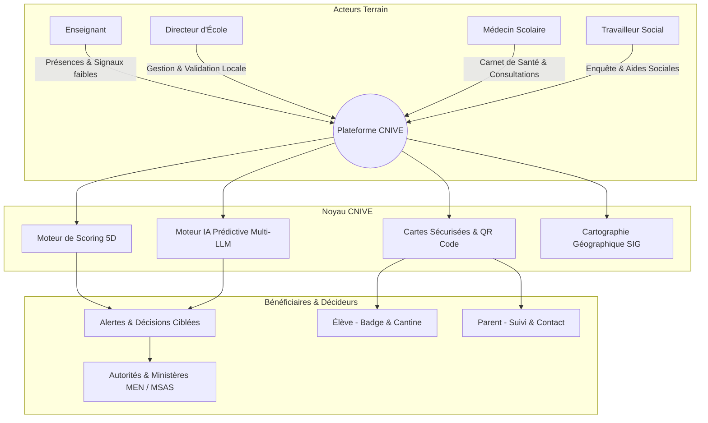
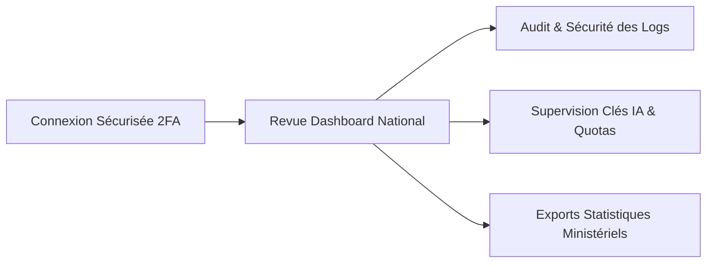
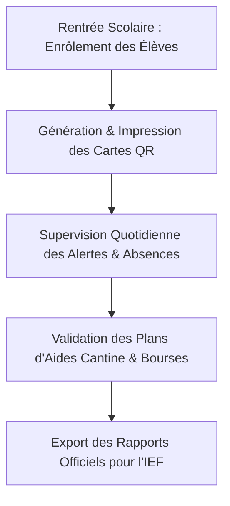
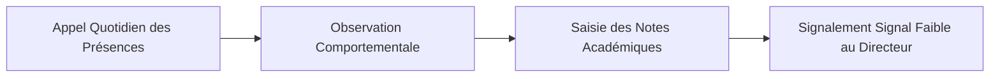
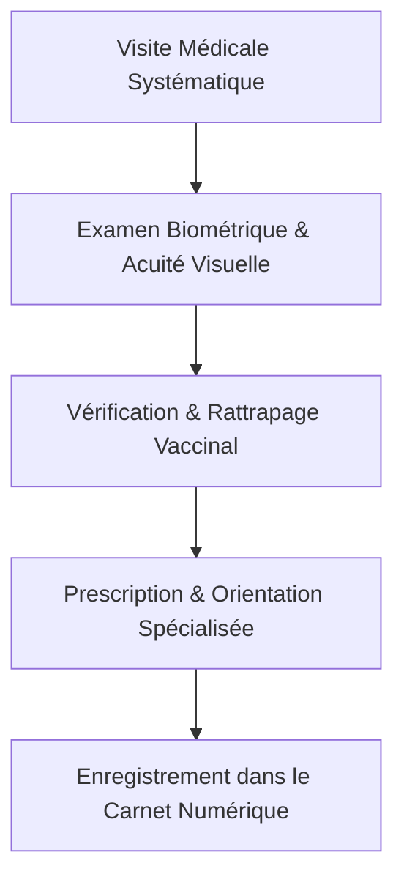
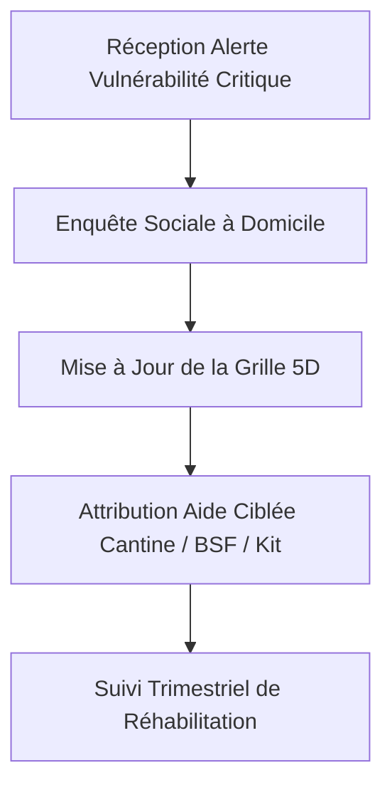

# LA BIBLE OFFICIELLE DE LA PLATEFORME CNIVE
## Cartographie Numérique Intégrée des Vulnérabilités de l'Enfant (Sèn-e-Carte — Sénégal)

---

> Ce document constitue le **manuel de référence institutionnel, technique et opérationnel** de la plateforme CNIVE. Il a été conçu pour former et guider l'ensemble des acteurs de l'écosystème éducatif, médical et social sénégalais. Chaque partie prenante doit s'y référer pour appliquer la bonne logique métier et respecter la souveraineté et la protection des données des enfants conformément à la législation de la Commission de Protection des Données Personnelles (CDP) du Sénégal.

---

---

# TABLE DES MATIÈRES

1. [Vision, Enjeux et Cadre Stratégique National](#1-vision-enjeux-et-cadre-stratégique-national)
2. [Architecture Technique, Sécurité & Multi-Tenancy](#2-architecture-technique-sécurité--multi-tenancy)
3. [Matrice des Rôles et des Permissions (RBAC)](#3-matrice-des-rôles-et-des-permissions-rbac)
4. [Guide Exhaustif Module par Module](#4-guide-exhaustif-module-par-module)
   - 4.1. Tableau de Bord & Pilotage Stratégique
   - 4.2. Base des Élèves & Gestion des Identités
   - 4.3. Grille Multidimensionnelle des Vulnérabilités (5D)
   - 4.4. Moteur d'IA Prédictive & Analyse Décisionnelle Multi-LLM
   - 4.5. Santé Scolaire & Carnet Médical Numérique
   - 4.6. Interventions Sociales & Prise en Charge Individualisée
   - 4.7. Cartographie SIG Interactive & Analyse Spatiale
   - 4.8. Cartes Numériques Sécurisées & Scanner Mobile QR
   - 4.9. Gestion des Absences & Détection du Décrochage
   - 4.10. Centre d'Alertes en Temps Réel
   - 4.11. Rapports Officiels, Fiches Individuelles & Exports PDF
   - 4.12. Gestion des Équipes & Habilitations Locales
   - 4.13. Journal d'Audit & Piste de Traçabilité Immuable
5. [Guides Pratiques et Procédures Opérationnelles (SOP) par Rôle](#5-guides-pratiques-et-procédures-opérationnelles-sop-par-rôle)
   - 5.1. Guide de l'Administrateur National / Système (GTE_ADMIN)
   - 5.2. Guide du Directeur d'Établissement (SCHOOL_DIRECTOR)
   - 5.3. Guide de l'Enseignant / Maître de Classe (TEACHER)
   - 5.4. Guide du Médecin / Personnel de Santé Scolaire (HEALTH_WORKER)
   - 5.5. Guide de l'Agent de la Protection Sociale (SOCIAL_WORKER)
   - 5.6. Guide pour l'Élève (Bénéficiaire)
   - 5.7. Guide pour le Parent d'Élève / Tuteur Légal
   - 5.8. Guide pour les Rôles Complémentaires (Inspecteurs IEF/IA, ONG, Cantiniers)
6. [Foire Aux Questions (FAQ) & Protocoles d'Urgence](#6-foire-aux-questions-faq--protocoles-durgence)

---

# 1. VISION, ENJEUX ET CADRE STRATÉGIQUE NATIONAL

### 1.1. Contexte et Raison d'Être
Au Sénégal, des milliers d'enfants scolarisés font face à des freins invisibles compromettant leur avenir : malnutrition silencieuse, acuité visuelle non dépistée, précarité économique extrême, violences ou éloignement géographique du domicile à l'école. Souvent, ces vulnérabilités sont constatées trop tard, lorsque l'enfant a déjà abandonné l'école.

La plateforme **CNIVE** (Cartographie Numérique Intégrée des Vulnérabilités de l'Enfant), adossée au dispositif **Sèn-e-Carte**, transforme radicalement ce paradigme :
- **Du traitement curatif vers l'anticipation prédictive :** Détecter les signaux faibles dès les premiers jours du trimestre.
- **Du cloisonnement vers la synergie intersectorielle :** Connecter dans une base unique et sécurisée l'Éducation, la Santé publique et l'Action Sociale.
- **De l'aide diffuse vers l'allocation chirurgicale :** S'assurer que chaque sac de riz, chaque bourse, chaque paire de lunettes bénéficie à l'enfant qui en a le plus besoin.

### 1.2. Conformité Légale & Éthique (CDP Sénégal)
La plateforme respecte rigoureusement la **Loi n° 2008-12 du 25 janvier 2008** sur la protection des données à caractère personnel :
- **Consentement et finalité stricte :** Les données des mineurs ne sont accessibles qu'aux professionnels légalement accrédités.
- **Droit à l'oubli et anonymisation :** Les profils publics issus des QR codes ne divulguent aucune information médicale confidentielle sans authentification forte.
- **Souveraineté des données :** Hébergement certifié garantissant l'intégrité de l'identité numérique de chaque enfant sénégalais.

---

# 2. ARCHITECTURE TECHNIQUE, SÉCURITÉ & MULTI-TENANCY

### 2.1. Principes de Sécurité
1. **Isolation Multi-Tenancy Stricte :**
   - Un directeur ou enseignant d'une école de Tambacounda ne peut en aucun cas voir ou modifier les données d'une école de Pikine ou Saint-Louis.
   - Les requêtes SQL backend intègrent automatiquement le filtre `school_id` correspondant au profil connecté (`scoping.py`).
2. **Authentification Forte & Mots de Passe :**
   - Hachage de pointe avec **bcrypt** et salage adaptatif.
   - Protection contre le brute-force via un **Rate Limiter** (`slowapi` : 10 tentatives/minute max).
   - Authentification à Deux Facteurs (2FA / TOTP) standard RFC 6238 activable pour tous les cadres administratifs.
3. **Piste d'Audit Immuable :**
   - Chaque action sensible (création d'élève, consultation de santé, génération de rapport, export de données) est immédiatement journalisée avec l'identité de l'utilisateur, son rôle, son adresse IP et la date exacte.

---

# 3. MATRICE DES RÔLES ET DES PERMISSIONS (RBAC)

| Rôle Système | Identifiant Code | Périmètre d'Accès | Actions Principales Autorisées |
| :--- | :--- | :--- | :--- |
| **Administrateur National** | `GTE_ADMIN` | **National** (Toutes les régions & écoles) | Pilotage global, gestion des comptes, paramétrage IA, audit complet, export des statistiques nationales. |
| **Directeur d'Établissement** | `SCHOOL_DIRECTOR` | **Son école uniquement** | Enrôlement des élèves, affectation des classes, génération des cartes scolaires, validation des demandes d'aides. |
| **Enseignant / Maître** | `TEACHER` | **Sa classe assignée** | Appel quotidien (absences), saisie des notes académiques, signalement des signaux faibles de vulnérabilité. |
| **Médecin / Infirmier** | `HEALTH_WORKER` | **Écoles du district sanitaire** | Visites médicales, vaccins, acuité visuelle, prescriptions, déclaration d'urgence sanitaire. |
| **Agent Protection Sociale** | `SOCIAL_WORKER` | **Commune / Département** | Enquêtes socio-économiques familiales, attribution des bourses, kits de vivres et suivi des interventions. |
| **Parent / Tuteur** | *Profil Public Sécurisé* | **Son enfant uniquement** | Scan QR code de la carte de son enfant, consultation du statut scolaire, appel d'urgence vers l'école. |
| **Élève** | *Bénéficiaire Carte* | **Carte personnelle** | Utilisation de la carte pour la présence, l'accès à la cantine, la bibliothèque et les examens officiels. |

---

# 4. GUIDE EXHAUSTIF MODULE PAR MODULE

### 4.1. Tableau de Bord & Pilotage Stratégique (`/`)
- **Indicateurs Clés de Performance (KPI) :**
  - **Effectif Total :** Nombre d'enfants enrôlés avec statut actif.
  - **Indice de Vulnérabilité Moyen :** Moyenne pondérée du score de l'établissement (0 à 10).
  - **Couverture Vaccinale :** Pourcentage d'élèves à jour de leur calendrier de santé.
  - **Alertes Actives :** Alertes nécessitant une intervention d'urgence sous 48h.
- **Répartition Graphique :**
  - Distribution par niveau de vulnérabilité (Faible / Modérée / Critique).
  - Répartition par genre (Parité Filles / Garçons).
  - Évolution mensuelle de l'assiduité et des signalements.

### 4.2. Base des Élèves & Gestion des Identités (`/pupils`)
- **Enrôlement Standardisé :**
  - Création de l'élève avec génération automatique de l'**Identifiant Unique CNIVE** (ex: `SN-DK-2026-00123`).
  - Saisie de l'état civil : Prénom, Nom, Date de naissance, Sexe, Adresse, Contacts des parents/tuteurs.
  - Intégration de la photo d'identité (via webcam ou fichier) avec recadrage et optimisation automatique.
- **Filtrage et Recherche Rapide :**
  - Filtrage instantané par **École** (menu déroulant relié à la base nationale), par classe (CI, CP, CE1, CE2, CM1, CM2), par statut et par niveau de vulnérabilité.
  - Barre de recherche tolérante aux fautes sur le nom, prénom ou identifiant matricule.

### 4.3. Grille Multidimensionnelle des Vulnérabilités (5D) (`/vulnerability`)
Le calcul de la vulnérabilité repose sur un modèle scientifique à **5 dimensions pondérées** :
1. **Dimension Nutritionnelle (Poids : 25 %) :**
   - Nombre de repas par jour (0-1 repas = critique ; 2 = modéré ; 3 = normal).
   - Indice de Masse Corporelle (IMC) et accès à la cantine scolaire.
2. **Dimension Santé & Handicap (Poids : 25 %) :**
   - Maladies chroniques (drépanocytose, asthme, diabète).
   - Déficience visuelle, auditive ou motrice non appareillée.
   - Statut vaccinal incomplet.
3. **Dimension Pédagogique & Assiduité (Poids : 20 %) :**
   - Moyenne générale trimestrielle (< 8/20 = signal fort).
   - Taux d'absentéisme mensuel (> 15 % = alerte automatique).
   - Retard d'apprentissage par rapport à la classe d'âge.
4. **Dimension Protection & Environnement Familial (Poids : 15 %) :**
   - Statut des parents (orphelinat de père/mère, garde par un tiers, enfants confiés).
   - Risque de travail précoce des enfants ou de mariage précoce.
   - Climat de sécurité au foyer.
5. **Dimension Économique & Logement (Poids : 15 %) :**
   - Revenu estimé du foyer, possession de la carte d'égalité des chances.
   - Distance du domicile à l'école (> 3 km à pied sans transport = facteur de décrochage).
   - Accès à l'eau potable et à l'électricité à domicile pour les devoirs.

> **Formule du Score Global :**
> $$\text{Score Global} = \sum_{i=1}^{5} (W_i \times D_i) \quad \text{sur une échelle de 0 à 10}$$
> - **0.0 à 3.9 (Vert) :** Vulnérabilité Faible (Suivi régulier).
> - **4.0 à 6.9 (Orange) :** Vulnérabilité Modérée (Priorité pour la cantine et kits de fournitures).
> - **7.0 à 10.0 (Rouge) :** Vulnérabilité Critique (Déclenchement immédiat du plan d'action intersectoriel).

### 4.4. Moteur d'IA Prédictive & Analyse Décisionnelle Multi-LLM (`/analytics`)
- **Routage Intelligent Multi-Fournisseurs :**
  - La plateforme intègre un routeur d'inférence adaptatif exploitant **Groq** (vitesse ultra-rapide), **OpenRouter** (modèles généralistes de pointe) et **xKiro** (modèles spécialisés).
  - En cas de saturation ou indisponibilité d'une clé API, le système bascule automatiquement sur le modèle alternatif sans interruption de service.
- **Fonctionnalités de l'IA :**
  - **Diagnostic Personnalisé :** Synthèse en français clair des facteurs combinés mettant l'enfant en péril.
  - **Plan de Sauvegarde Scolaire :** Recommandation de 3 actions concrètes et hiérarchisées pour l'école et le travailleur social.
  - **Analyse Prédictive de Grappe :** Détection d'anomalies collectives (ex: baisse généralisée de l'assiduité dans un village liée à une épidémie saisonnière de paludisme ou aux récoltes).

### 4.5. Santé Scolaire & Carnet Médical Numérique (`/health`)
- **Fiche Médicale Confidentielle :**
  - Groupe sanguin, allergies médicamenteuses majeures, acuité visuelle (œil gauche / œil droit).
  - Suivi biométrique : Poids (kg), Taille (cm), calcul automatique du percentil OMS.
- **Suivi Vaccinal Obligatoire :**
  - BCG, Polio, Pentavalent, Rougeole-Rubéole (RR), Fièvre Jaune.
  - Enregistrement des dates d'injection et alertes automatiques pour les rappels non effectués.
- **Journal des Consultations Médicales :**
  - Motif de consultation (maux de tête, traumatismes, fièvre, dépistage de routine).
  - Diagnostic, prescription médicale et orientation vers le poste de santé ou l'hôpital de district.

### 4.6. Interventions Sociales & Prise en Charge Individualisée (`/interventions`)
- **Types d'Interventions Référencées :**
  1. *Aide Alimentaire :* Inscription prioritaire à la cantine scolaire gratuite.
  2. *Matériel Éducatif :* Attribution de cartables, livres, uniformes et bicyclettes.
  3. *Appui Sanitaire :* Financement de lunettes de vue, soins dentaires ou médicaments.
  4. *Soutien Économique :* Liaison avec la Bourse de Sécurité Familiale (BSF).
  5. *Accompagnement Psycho-Social :* Médiation familiale, écoute psychologique.
- **Statut du Cycle de Vie :**
  `PLANIFIÉE` $\rightarrow$ `EN COURS` $\rightarrow$ `COMPLÉTÉE` ou `ANNULÉE`.
  Chaque étape requiert une note de suivi d'impact pour vérifier que l'aide a réellement amélioré la situation de l'enfant.

### 4.7. Cartographie SIG Interactive & Analyse Spatiale (`/map`)
- Visualisation interactive du Sénégal avec géoréférencement précis des 14 régions et des communes pilotes.
- **Couches de Données (Layers) :**
  - Carte de densité des élèves vulnérables (Heatmap).
  - Indicateur d'équipement des écoles (Présence de cantine, point d'eau potable, latrines séparées filles/garçons).
  - Rayon d'action des centres de santé et postes de protection sociale.

### 4.8. Cartes Numériques Sécurisées & Scanner Mobile QR (`/cards` & `/scan/:id`)
- **La Carte Scolaire Sèn-e-Carte :**
  - Format carte bancaire / pièce d'identité standard.
  - Contient la photo de l'élève, son nom, matricule, école et un **QR Code dynamique sécurisé**.
  - Impression recto-verso directe en PDF haute définition.
- **Le Scanner Mobile Universel :**
  - Fonctionne avec n'importe quel smartphone équipé d'une caméra sans obligation d'installer une application tierce.
  - **Double Comportement au Scan :**
    - *Utilisateur Authentifié (Enseignant/Directeur/Médecin) :* Redirection automatique vers le dossier complet et modifiable de l'élève.
    - *Grand Public / Parent / Secouriste :* Affichage d'une page publique sécurisée présentant l'identité de l'enfant, l'école, le numéro d'urgence des parents et du directeur, sans exposer de données médicales sensibles.
  - **Géolocalisation d'Urgence :** Si un enfant égaré ou blessé a sa carte scannée, la position GPS peut être transmise aux services de secours avec horodatage.

### 4.9. Gestion des Absences & Détection du Décrochage
- Enregistrement des absences par demi-journée.
- Qualification des motifs (Maladie, Obligation familiale, Manque de moyens, Non justifiée).
- Seuil critique d'alerte : **3 jours d'absence consécutifs non justifiés** ou **plus de 6 jours dans le mois** déclenchent automatiquement une notification vers le directeur et le travailleur social.

### 4.10. Centre d'Alertes en Temps Réel (`/alerts`)
- Flux centralisé filtrable par niveau de sévérité (`INFO`, `ATTENTION`, `CRITIQUE`).
- Traitement collaboratif : assignation d'une alerte à un membre de l'équipe avec commentaire de suivi jusqu'à sa résolution.

### 4.11. Rapports Officiels, Fiches Individuelles & Exports PDF (`/reports`)
- Moteur d'exportation certifié utilisant `ReportLab` :
  - **Fiche Navette Individuelle :** Document A4 officiel regroupant photo, état civil, grille de vulnérabilité et historique des interventions.
  - **Bilan d'Établissement :** Rapport statistique destiné à l'Inspection de l'Éducation et de la Formation (IEF).
  - **Bordereau Cantine :** Liste certifiée des élèves prioritaires pour les dotations en denrées.

### 4.12. Gestion des Équipes & Habilitations Locales (`/team`)
- Création sécurisée des collaborateurs par le Directeur ou l'Admin.
- Attribution stricte du rôle et de l'école de rattachement.
- Activation ou désactivation instantanée d'un compte en cas de mutation ou départ.

### 4.13. Journal d'Audit & Piste de Traçabilité Immuable (`/audit`)
- Enregistrement inviolable de toutes les requêtes : qui a accédé à quelle fiche, à quelle heure, depuis quelle IP.
- Export légal pour les inspections officielles de la CDP ou du Ministère.

---

# 5. GUIDES PRATIQUES ET PROCÉDURES OPÉRATIONNELLES (SOP) PAR RÔLE

---

## 5.1. GUIDE DE L'ADMINISTRATEUR NATIONAL / SYSTÈME (`GTE_ADMIN`)

### Mission Principale :
Garantir l'intégrité, la sécurité, la disponibilité de la plateforme et fournir aux décideurs ministériels les données macroéconomiques et statistiques consolidées.

### Routine Opérationnelle Pas à Pas :
1. **Connexion & Sécurité :**
   - Connectez-vous sur `/login` avec votre adresse institutionnelle.
   - Entrez votre code TOTP généré par Google Authenticator ou Microsoft Authenticator.
2. **Supervision Nationale :**
   - Ouvrez le Dashboard (`/`). Consultez la répartition des vulnérabilités par académie (IA) et département (IEF).
   - Identifiez les zones géographiques présentant un pic anormal de signaux critiques.
3. **Gestion des Écoles et des Comptes Directeurs :**
   - Rendez-vous sur `/team`. Créez les comptes des nouveaux directeurs d'école en renseignant scrupuleusement leur établissement d'affectation.
   - En cas d'oubli de mot de passe d'un directeur, utilisez la fonction de réinitialisation sécurisée.
4. **Maintenance de l'IA & des Clés API :**
   - Rendez-vous dans `/settings` ou dans la configuration backend pour vérifier la validité des quotas des clés LLM (Groq, OpenRouter, xKiro).
   - Testez la génération prédictive sur un échantillon test pour vous assurer de la fluidité des inférences.
5. **Audit de Conformité CDP :**
   - Ouvrez `/audit`. Filtrez par action `LOGIN_FAILED` ou `DELETE_PUPIL` pour vérifier l'absence de tentatives d'intrusion ou d'anomalies de suppression.

---

## 5.2. GUIDE DU DIRECTEUR D'ÉTABLISSEMENT (`SCHOOL_DIRECTOR`)

### Mission Principale :
Être le garant de la complétude de la base de son école, piloter les interventions locales et coordonner l'équipe pédagogique et médico-sociale.

### Routine Opérationnelle Pas à Pas :
1. **Rentrée Scolaire — Enrôlement :**
   - Rendez-vous dans **Base des élèves** (`/pupils`).
   - Cliquez sur **+ Nouvel élève**.
   - Renseignez l'état civil complet, la classe (CI à CM2) et capturez la photo de l'élève.
   - Renseignez impérativement les coordonnées téléphoniques d'au moins un parent ou tuteur.
2. **Production des Cartes Scolaires :**
   - Rendez-vous dans **Cartes scolaires** (`/cards`).
   - Cliquez sur **Générer les cartes manquantes**.
   - Sélectionnez votre école et lancez l'impression groupée en PDF. Faites plastifier les cartes et distribuez-les aux élèves dès la première semaine.
3. **Contrôle Quotidien :**
   - Chaque matin à 10h, consultez le module **Alertes** (`/alerts`).
   - Passez en revue les élèves déclarés absents depuis plus de 48 heures par les enseignants.
4. **Comité de Vulnérabilité Mensuel :**
   - Rassemblez l'infirmier scolaire et le travailleur social.
   - Ouvrez **Analyses IA** (`/analytics`) pour passer en revue la liste des élèves en zone rouge (score $\ge 7.0$).
   - Validez l'attribution des repas de cantine gratuits et des bourses de fournitures dans le module **Interventions** (`/interventions`).
5. **Rapport à l'Inspection (IEF) :**
   - En fin de trimestre, allez dans **Rapports** (`/reports`), générez le rapport consolidé de l'école et transmettez-le à l'Inspecteur.

---

## 5.3. GUIDE DE L'ENSEIGNANT / MAÎTRE DE CLASSE (`TEACHER`)

### Mission Principale :
Assurer la veille quotidienne au contact des enfants, saisir les assiduités et signaler immédiatement les signes précurseurs de détresse ou de décrochage.

### Routine Opérationnelle Pas à Pas :
1. **Appel du Matin :**
   - Connectez-vous sur votre smartphone ou tablette de classe.
   - Ouvrez la liste de votre classe et cochez les élèves absents en indiquant si le motif est connu (ex: maladie signalée par la famille).
2. **Détection des Signaux Faibles :**
   - *Comportement :* Enfant qui s'endort fréquemment en classe (signe possible de malnutrition ou travail nocturne).
   - *Santé visible :* L'enfant plisse les yeux pour lire au tableau (problème d'acuité visuelle) ou présente des plaies/lésions cutanées.
   - *Matériel :* Absence prolongée de cahiers ou d'uniforme.
3. **Signalement dans l'Application :**
   - Ouvrez la fiche de l'élève (`/pupils/:id`).
   - Cliquez sur **Ajouter une observation / Signalement**.
   - Décrivez succinctement le fait constaté : une alerte discrète sera transmise au directeur et au travailleur social.
4. **Fin de Période :**
   - Saisissez les moyennes académiques pour mettre à jour la dimension cognitive du score de vulnérabilité.

---

## 5.4. GUIDE DU MÉDECIN / PERSONNEL DE SANTÉ SCOLAIRE (`HEALTH_WORKER`)

### Mission Principale :
Dépister précocement les pathologies, garantir la couverture vaccinale et lever tout obstacle médical à la scolarisation.

### Routine Opérationnelle Pas à Pas :
1. **Déroulement d'une Visite Médicale :**
   - Scannez le QR code de la carte de l'élève ou cherchez-le dans le module **Santé** (`/health`).
   - Ouvrez son dossier médical.
2. **Mesures Biométriques & Dépistage :**
   - Pesez et mesurez l'enfant : l'IMC et la courbe de croissance sont calculés automatiquement.
   - Testez l'acuité visuelle avec l'échelle de Monoyer : si la vision est $\le 6/10$, cochez la case *Besoin de correction optique*.
3. **Contrôle Vaccinal :**
   - Vérifiez le carnet de vaccination. Cochez les doses administrées et inscrivez la date.
   - Si un vaccin du Programme Élargi de Vaccination (PEV) manque, programmez une date de rattrapage.
4. **Prescription et Traitement :**
   - Renseignez les prescriptions (ex: déparasitage systématique, compléments en fer/vitamines).
   - Si une pathologie grave est suspectée (malnutrition aiguë, cardiopathie), activez l'indicateur **Urgence Médicale** pour déclencher une prise en charge prioritaire.

---

## 5.5. GUIDE DE L'AGENT DE LA PROTECTION SOCIALE (`SOCIAL_WORKER`)

### Mission Principale :
Analyser l'environnement socio-familial de l'enfant, valider l'éligibilité aux aides institutionnelles et assurer l'accompagnement de la famille.

### Routine Opérationnelle Pas à Pas :
1. **Traitement des Alertes Prioritaires :**
   - Rendez-vous sur le module **Vulnérabilités** (`/vulnerability`).
   - Triez par score décroissant. Concentrez-vous sur les élèves avec un score $\ge 7.0$ non pris en charge.
2. **Enquête Sociale :**
   - Contactez la famille ou effectuez une visite à domicile.
   - Évaluez les conditions de vie réelles : profession des parents, statut d'habitat, fratrie scolarisée, possession de la carte d'égalité des chances.
3. **Mise à Jour de l'Évaluation :**
   - Complétez la grille des 5 dimensions avec les données vérifiées sur le terrain.
   - Consultez les recommandations du **moteur IA** pour orienter la décision.
4. **Attribution d'une Intervention :**
   - Rendez-vous dans **Interventions** (`/interventions`) $\rightarrow$ **Nouvelle intervention**.
   - Choisissez le type : *Bourse scolaire*, *Cantine 100 % prise en charge*, *Kit de dignité*, *Transfert monétaire d'urgence*.
   - Définissez les objectifs (ex: ramener l'assiduité de l'élève à plus de 90 % en 60 jours).
5. **Suivi d'Impact :**
   - Après 6 semaines, ouvrez la fiche d'intervention et saisissez la note d'impact pour clore le dossier ou prolonger l'aide.

---

## 5.6. GUIDE POUR L'ÉLÈVE (BÉNÉFICIAIRE)

### Ce que l'Élève doit savoir :
1. **Ma Carte est Mon Passeport Éducatif :**
   - L'élève doit toujours porter sa carte scolaire CNIVE sur lui, dans son cartable ou autour du cou.
   - Elle ne doit être ni prêtée, ni griffonnée, ni pliée.
2. **Utilisation au Quotidien :**
   - **À l'entrée de l'école ou en classe :** Présenter sa carte au maître pour valider sa présence.
   - **À la cantine scolaire :** La carte est scannée pour recevoir son plateau repas sans avoir besoin d'argent liquide.
   - **À l'infirmerie scolaire :** Présenter la carte au médecin pour retrouver son dossier de santé.
3. **En cas de perte :**
   - L'élève doit immédiatement prévenir son maître de classe ou le directeur. Une nouvelle carte sera imprimée sans perte de son historique.

---

## 5.7. GUIDE POUR LE PARENT D'ÉLÈVE / TUTEUR LÉGAL

### Ce que le Parent peut faire :
1. **Consulter la Carte de son Enfant :**
   - En scannant le QR code avec n'importe quel téléphone muni d'un appareil photo, le parent accède à la **fiche publique sécurisée**.
2. **Vérifier les Informations :**
   - S'assurer que le numéro de téléphone enregistré est exact afin que l'école puisse le joindre en cas d'accident ou de malaise.
   - Vérifier le statut vaccinal de son enfant et les dates des prochaines visites médicales scolaires.
3. **Contacter l'École en 1 Clic :**
   - La page publique dispose d'un bouton d'appel direct vers le bureau du directeur.
4. **Protection de la Vie Privée :**
   - Le parent est assuré que les notes scolaires détaillées et les antécédents médicaux intimes ne sont jamais affichés aux inconnus qui scanneraient la carte dans la rue.

---

## 5.8. GUIDE POUR LES RÔLES COMPLÉMENTAIRES

### A. Inspecteurs de l'Éducation (IEF / IA) :
- Accès aux tableaux de bord consolidés par commune et département.
- Suivi du taux d'abandon scolaire en temps réel pour orienter la carte scolaire et les constructions de classes.
- Évaluation de l'efficacité des cantines scolaires subventionnées par l'État.

### B. Partenaires Techniques et Bailleurs (ONG, UNICEF, PAM, etc.) :
- Consultation des statistiques agrégées et anonymisées sur les déficits nutritionnels et matériels.
- Ciblage direct des livraisons de vivres ou de fournitures scolaires sur les écoles les plus vulnérables sans intermédiaires.

### C. Cantiniers & Gestionnaires de Cantine :
- Utilisation de la fonction scanner mobile en mode "Cantine" pour enregistrer les passages.
- Élimination des fraudes et gestion précise des stocks alimentaires restants.

---

# 6. FOIRE AUX QUESTIONS (FAQ) & PROTOCOLES D'URGENCE

### Q1 : Que faire si l'école subit une coupure d'électricité ou d'internet ?
> **Réponse :** La plateforme CNIVE a été optimisée pour la résilience :
> 1. Les cartes scolaires physiques avec QR code continuent de fonctionner hors-ligne.
> 2. L'application enregistre les saisies locales en mémoire tampon (cache) et synchronise automatiquement les présences et consultations dès le retour de la connexion.

### Q2 : Comment signaler un cas suspect de maltraitance ou de danger immédiat pour un enfant ?
> **Protocole d'Urgence :**
> 1. Tout enseignant ou personnel soignant constatant des blessures suspectes ou un témoignage grave doit immédiatement créer une alerte de type `CRITIQUE` dans le module **Alertes**.
> 2. Prévenir verbalement le Directeur d'établissement.
> 3. L'Agent de la Protection Sociale est automatiquement notifié par SMS/Notification et prend attache avec le tribunal d'instance ou les services de l'AEMO (Action Éducative en Milieu Ouvert).

### Q3 : Un élève change d'établissement (transfert vers une autre région). Comment procéder ?
> **Protocole de Transfert :**
> 1. Le directeur d'origine se rend sur la fiche de l'élève (`/pupils/:id`) et sélectionne le statut `TRANSFÉRÉ`.
> 2. Il sélectionne l'école d'accueil dans le menu déroulant national.
> 3. Le directeur de la nouvelle école reçoit une notification, valide la réception de l'élève et conserve l'intégralité du carnet de santé et de l'historique sans rupture de suivi.

### Q4 : Que faire si le scanner de carte affiche "Élève non trouvé" ?
> **Résolution :**
> 1. Vérifier que la lentille de la caméra du téléphone est propre.
> 2. Si le QR code est abîmé, saisir manuellement le code matricule CNIVE à 8 caractères sur la page d'accueil de la recherche.
> 3. Si le problème persiste, réimprimer un nouvel exemplaire de la carte depuis le module `/cards`.

---

> **Plateforme CNIVE / Sèn-e-Carte — République du Sénégal**  
> *Pour une école républicaine inclusive, protectrice et résolument tournée vers l'avenir de chaque enfant.*
